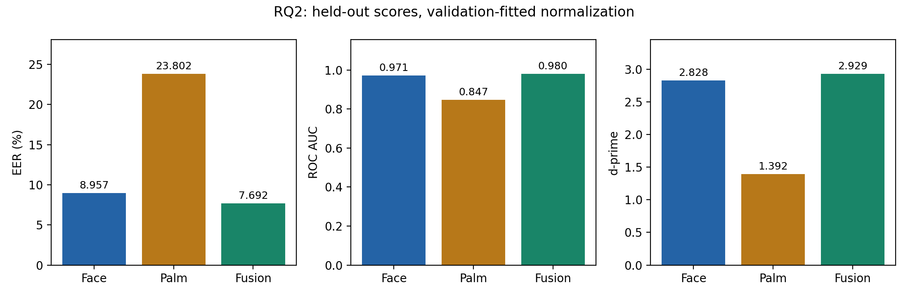
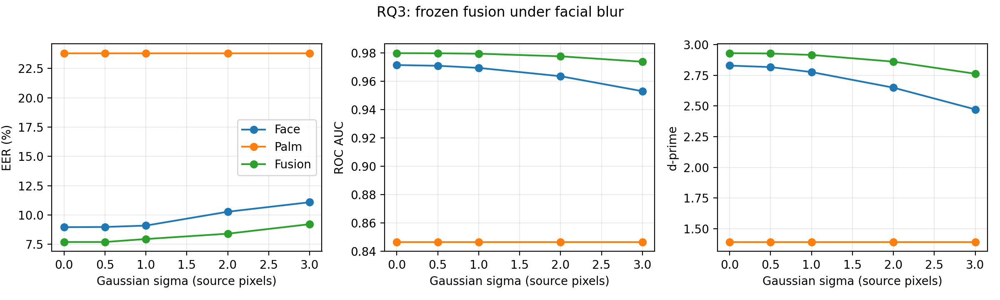

# CAP4103 Final Project

## Combining Face and Palmprint Scores for Authentication Under Image Blur

**University of South Florida | CAP4103 Mobile Biometrics | Fall 2026**

**Instructor:** Dr. Tempestt Neal

**Team:** The Classifiers

### Team Members

- Nafis Anwar
- Nazmus Sakeeb
- Diego Laverdy
- Mikaela Kelly
- Sienah Spears

## 1. Project Overview

This project implements and evaluates a multimodal biometric authentication system combining facial recognition and palmprint recognition.

Three connected experiments evaluate individual authentication performance, equal-weight score-level fusion, and authentication performance under progressively increasing facial image blur.

The implementation includes dataset preparation, identity alignment, enrollment, feature extraction, template matching, similarity scoring, fusion, performance evaluation, and experimental verification.

The evaluation module directly reuses the submitted HW3 numerical evaluator in `src/hw3_evaluator.py`. The project supplies empirical score thresholds, interpolates EER and calculates ROC AUC for real biometric scores. The unchanged HW3 source is archived in `docs/hw3_original.py.txt`; the separate PPA3 implementation remains historical evidence.

## 2. Research Questions

### RQ1: Individual Authentication Performance

How do face-only and palmprint-only authentication systems compare in terms of Equal Error Rate (EER), ROC AUC and d-prime under clear-image conditions?

### RQ2: Score-Level Fusion

Does equal-weight fusion of validation-normalized face and palmprint matching scores improve authentication performance relative to either individual modality under clear-image conditions?

### RQ3: Facial Image Degradation

As Gaussian blur increases in facial test images while palmprint image quality remains unchanged, how does equal-weight score-level fusion affect authentication performance compared with face-only and palmprint-only authentication?

RQ1 established that face authentication performed better than palmprint authentication. RQ2 investigated whether palmprint scores nevertheless provided complementary information. Following the observed improvement from fusion, RQ3 evaluated whether this advantage persisted under facial image degradation.

## 3. Datasets and Experimental Protocol

The system uses two course-approved biometric datasets:

- [Olivetti Faces Dataset](https://scikit-learn.org/stable/modules/generated/sklearn.datasets.fetch_olivetti_faces.html)
- [Birjand University Mobile Palmprint Database](https://www.kaggle.com/datasets/mahdieizadpanah/birjand-university-mobile-palmprint-databasebmpd)
- [BMPD Research Publication](https://doi.org/10.1504/IJGUC.2019.102016)

Olivetti contains 400 grayscale facial images from 40 individuals. The BMPD audit examined 812 right-palm images from 41 individuals, of which 751 were usable after quality and duplicate checks.

A fixed artificial identity mapping aligns 39 eligible face subjects with 39 eligible palmprint subjects. These are different physical individuals represented by common simulated identities.

| Parameter | Value |
|---|---:|
| Simulated identities | 39 |
| Images per identity per modality | 10 |
| Enrollment images per modality | 156 |
| Validation images per modality | 78 |
| Test images per modality | 156 |
| Total selected images | 780 |
| Validation claims | 3,042 |
| Test claims | 6,084 |
| Random seed | 42 |

Each validation or test probe is compared against all 39 enrolled identities.

The validation partition contains 78 genuine and 2,964 impostor claims. The test partition contains 156 genuine and 5,928 impostor claims.

Palmprint enrollment and validation use first-session captures, while testing uses second-session captures. Facial images use a seeded within-subject partition.

## 4. Authentication System

| Component | Implementation |
|---|---|
| Facial preprocessing | 64 x 64 grayscale images |
| Facial representation | PCA with 64 components |
| Palmprint preprocessing | Skin segmentation and central ROI extraction |
| Palmprint representation | HOG with 1,764 features |
| Enrollment | L2-normalized mean feature templates |
| Matching | Cosine similarity |
| Score normalization | Validation-only Z-score normalization |
| Fusion | Equal-weight normalized score averaging |
| Image degradation | Gaussian filtering of facial probes |
| Evaluation | EER, ROC AUC, d-prime, FAR, FRR and score distributions |

Feature settings are selected using validation performance. Authentication models are fitted using enrollment samples only.

The fused score is calculated as:

    Fusion = 0.5 * NormalizedFace + 0.5 * NormalizedPalm

RQ3 preserves enrollment models, normalization parameters, palmprint scores, claim identities and fusion weights. Gaussian blur is applied only to facial test probes.

## 5. Experimental Results

### RQ1 and RQ2: Clear-Image Authentication

| System | EER (%) | ROC AUC | D-prime |
|---|---:|---:|---:|
| Face only | 8.96 | 0.9714 | 2.8283 |
| Palmprint only | 23.80 | 0.8465 | 1.3925 |
| Equal-weight fusion | 7.69 | 0.9797 | 2.9294 |

Fusion reduced observed EER by 1.27 percentage points compared with face-only authentication and 16.11 percentage points compared with palmprint-only authentication.

### RQ3: Authentication Under Facial Image Blur

| Gaussian Sigma | Face EER (%) | Palmprint EER (%) | Fusion EER (%) |
|---:|---:|---:|---:|
| 0.0 | 8.96 | 23.80 | 7.69 |
| 0.5 | 8.97 | 23.80 | 7.69 |
| 1.0 | 9.09 | 23.80 | 7.95 |
| 2.0 | 10.27 | 23.80 | 8.40 |
| 3.0 | 11.08 | 23.80 | 9.21 |

Fusion achieved the lowest observed EER across all five evaluated blur levels.

Complete EER, ROC AUC and d-prime results are available in the experimental CSV files.

## 6. Experimental Controls

| Setting | RQ1 | RQ2 | RQ3 |
|---|---|---|---|
| Dataset partitions | Fixed | Fixed | Fixed |
| Enrollment models | Fitted | Frozen | Frozen |
| Matching method | Cosine | Cosine | Cosine |
| Score normalization | None | Validation-fitted | Frozen |
| Fusion weights | None | 0.5 / 0.5 | 0.5 / 0.5 |
| Face blur | None | None | Five sigma levels |
| Palmprint quality | Unchanged | Unchanged | Unchanged |

## 7. Repository Structure

| Location | Description |
|---|---|
| src/ | Authentication, preprocessing, matching, fusion and evaluation |
| experiments/ | Executable RQ1, RQ2 and RQ3 implementations |
| data/manifests/ | Dataset inventories, identity mappings, partitions and claims |
| data/raw/ | Original dataset assets |
| data/processed/ | Frozen models and experiment configuration |
| results/metrics/ | Scores, numerical results and verification evidence |
| results/figures/ | ROC curves, distributions and comparative graphs |
| scripts/ | Dataset acquisition and verification utilities |
| tests/ | Automated unit and integration tests |
| ppa3_legacy/ | Original performance evaluation and regression inputs |
| docs/ | Technical methodology and verification documentation |

## 8. Software Environment

The original experiments were verified using:

- Python 3.13.2
- Windows 11
- AMD Ryzen 9 7940HS
- Approximately 16 GB RAM
- Random seed 42

| Library | Version |
|---|---|
| NumPy | 2.3.2 |
| SciPy | 1.16.3 |
| scikit-learn | 1.9.1 |
| scikit-image | 0.26.0 |
| Matplotlib | 3.10.7 |
| Pillow | 13.0.0 |
| joblib | 1.6.0 |

Exact dependencies are recorded in requirements-lock.txt.

No dedicated GPU is required.

## 9. Windows Installation

Open PowerShell in the project root.

Create the virtual environment:

    py -3.13 -m venv .venv

Install dependencies:

    .\.venv\Scripts\python.exe -m pip install -r requirements-lock.txt

Check dependencies:

    .\.venv\Scripts\python.exe -m pip check

For an authorized Git checkout, download the stored Git LFS assets:

    git lfs install
    git lfs pull

GitHub-generated source archives may contain LFS pointers instead of actual dataset or model files. Full experimental reproduction requires the underlying assets.

## 10. Verify Saved Results

The saved-score audit recalculates performance metrics, verifies aligned claims, checks validation-only normalization, confirms equal-weight fusion and compares repeated experimental runs.

    .\.venv\Scripts\python.exe -B scripts/review_submission.py --rq2-run rq2_main_verified_20261116 --rq3-run rq3_main_verified_20261116 --repeat-run rq3_main_repeat_20261116 --output results/metrics/grader_audit

Choose a new output directory for each execution.

This audit verifies saved numerical evidence. It does not independently retrain authentication models from raw images.

## 11. Reproduce the Experiments

Full image-level reproduction requires the original datasets, fixed manifests, frozen model assets and recorded blur plan.

### RQ1: Individual Authentication

    .\.venv\Scripts\python.exe experiments/rq1_baseline.py --run-id rq1_reproduction

RQ1 refits the individual authentication models using the fixed enrollment partition and evaluates the held-out test partition.

### RQ2: Score-Level Fusion

    .\.venv\Scripts\python.exe experiments/rq2_fusion.py --run-id rq2_reproduction

RQ2 uses the accepted baseline scores and fits normalization parameters exclusively from validation scores.

### RQ3: Facial Image Degradation

    .\.venv\Scripts\python.exe experiments/rq3_blur.py run --rq2-run rq2_reproduction --plan data/processed/blur_plans/integration_20261116/blur_plan.json --run-id rq3_reproduction

RQ3 uses the accepted frozen authentication models and the normalization parameters associated with the specified RQ2 run.

Each reproduction run must have a unique identifier. Existing experimental results are preserved.

## 12. Automated Verification

Execute the complete study verification:

    .\.venv\Scripts\python.exe -B scripts/verify_study.py

The verification workflow checks:

- Accepted RQ1 artifact integrity
- All 812 raw palmprint file hashes
- Automated unit and integration tests
- Original HW3/PPA3 regression
- RQ2 repeatability
- RQ3 score alignment and metric integrity
- Sigma-zero equivalence
- Exact palmprint score invariance

The recorded integrated verification passed all 57 tests with zero skips.

Individual checks:

    .\.venv\Scripts\python.exe -B -m unittest discover -s tests -v

    .\.venv\Scripts\python.exe -B scripts/verify_legacy.py

Full verification requires actual dataset and model assets.

## 13. Results Traceability

| Experiment | Verified Run |
|---|---|
| RQ1 | rq1_main_verified_20261116 |
| RQ2 | rq2_main_verified_20261116 |
| RQ3 | rq3_main_verified_20261116 |

Primary result files:

- [Clear-condition metrics](results/metrics/main_integration_20261116/report_clear_metrics.csv)
- [Blur-condition metrics](results/metrics/main_integration_20261116/report_blur_metrics.csv)
- [Master experimental metrics](results/metrics/main_integration_20261116/score_audit/study_master_metrics.csv)
- [Reproduction comparison](results/metrics/main_integration_20261116/reproduction_comparison.json)

## 14. Technical Documentation

- [Experimental methodology](docs/methodology.md)
- [Data contracts](docs/data_contracts.md)
- [Technical verification](docs/verification.md)

## 15. Limitations and Ethical Considerations

The study examines a small, artificially paired biometric population. The results do not establish naturally paired multimodal performance, statistical significance, demographic fairness or deployment-level authentication accuracy.

Gaussian filtering represents controlled degradation of facial image sharpness. Palmprint region extraction does not include explicit anatomical or rotational alignment.

Production deployment would require additional safeguards, including access controls, encryption, biometric template protection, limited retention, appropriate consent and secure authentication fallback.

Dataset use and distribution must comply with the original dataset terms.
